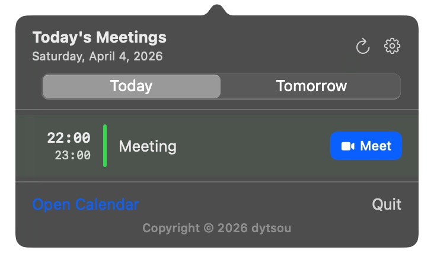

[](https://github.com/dytsou/ProxiMeeting/actions/workflows/build.yml)
[](https://github.com/dytsou/ProxiMeeting/releases)
[](LICENSE)

<p align="center">
  
</p>

# ProxiMeeting

在 Mac 選單列顯示下一場會議的 macOS 小工具。



## 功能

- 在選單列顯示下一場會議的開始時間
- 會議進行中時顯示「進行中」
- 點擊展開目前瀏覽日的會議清單（開啟時捲動到第一場尚未結束的會議）
- **瀏覽其他日期：** 左右方向鍵或標題列日期控制（約可看昨天到兩週後；接近邊界時視窗可再延伸）
- 拖曳彈出視窗右下角可調整大小
- 可從清單封存會議，使其不再出現在選單列；在**過去的會議 → 淡化**時，已結束與已封存項目仍會以淡化列顯示於彈出視窗
- 自動偵測視訊會議連結（Zoom、Google Meet、Teams、Webex、Whereby）
- 偵測到連結時顯示一鍵加入按鈕；**設定 → 會議連結**可為各服務分別選擇以 **App** 或**瀏覽器**開啟
- **行事曆來源：** **設定 → 行事曆來源**可指定要讀取哪些 Apple 行事曆
- **外觀：** **設定 → 外觀**可調整清單／選單列字體、標題長度，以及今日過去的會議要**隱藏**或**淡化**
- 每 60 秒自動更新，行事曆有異動時立即刷新
- 每日檢查更新（GitHub Releases），並在 App 內提供更新連結
- 支援英文與繁體中文（依系統語言自動切換）

## 系統需求

- macOS 13 Ventura 或更新版本
- macOS 行事曆 App 已與 Google 帳號同步
- **用 `./build.sh` 建置：** 只需 Xcode Command Line Tools（約 500 MB），**不必**安裝完整 Xcode
- **要開啟產生的 `.xcodeproj`：** 需完整 Xcode（方式 B）

## 設定步驟

### 1. 同步 Google 行事曆

開啟**行事曆 App** → 偏好設定 → 帳號 → 新增 Google 帳號。ProxiMeeting 直接讀取系統行事曆，無需 API 金鑰或 OAuth 授權。

### 2. 使用 Homebrew 安裝

透過 [Homebrew tap](https://github.com/dytsou/homebrew-proximeeting) 以 Cask 安裝圖形介面 App：

```bash
brew tap dytsou/proximeeting
brew install --cask proximeeting
```

#### 使用 Homebrew 更新

```bash
brew update
brew upgrade --cask proximeeting
```

`brew update` 只會更新 Homebrew 的 formula 與 tap 中繼資料，不會單獨安裝或升級 App。先確認目前的安裝是否由 Homebrew 管理：

```bash
brew list --cask --versions proximeeting
```

如果沒有顯示版本，請先安裝 cask：

```bash
brew tap dytsou/proximeeting
brew install --cask proximeeting
```

如果原本是手動安裝的 App，且安裝時因為已有同名 App 而發生覆蓋錯誤，可使用：

```bash
brew install --cask --force dytsou/proximeeting/proximeeting
```

如果 Homebrew 顯示 cask 來自不受信任的 tap，只信任這個 cask 後再重試：

```bash
brew trust --cask dytsou/proximeeting/proximeeting
```

安裝完成後，請關閉並重新開啟 ProxiMeeting。如果 Homebrew 顯示 cask 已安裝，但 `/Applications/ProxiMeeting.app` 不存在，請修復 cask 產物：

```bash
brew reinstall --cask --force dytsou/proximeeting/proximeeting
```

確認實際安裝版本：

```bash
/usr/libexec/PlistBuddy -c 'Print :CFBundleShortVersionString' \
  /Applications/ProxiMeeting.app/Contents/Info.plist
```

如果仍然更新失敗，再收集詳細輸出：

```bash
brew upgrade --cask proximeeting --verbose
brew doctor
```

若未使用 Homebrew 安裝，則需先建置 App。

**方式 A — 僅 Command Line Tools**（不需完整 Xcode App）：

1. 若尚未安裝，執行安裝。若 `xcode-select --install` 顯示**已安裝**，可略過；之後可透過**系統設定 → 一般 → 軟體更新**安裝更新。

   ```bash
   xcode-select --install
   ```

2. 將作用中的開發者目錄指向獨立的 Command Line Tools（僅在 `xcode-select -p` 顯示 `Xcode.app` 路徑時需要執行一次）：

   ```bash
   sudo xcode-select -s /Library/Developer/CommandLineTools
   ```

   僅使用 CLI 建置時，`xcode-select -p` 應顯示 `/Library/Developer/CommandLineTools`。

3. 建置：

   ```bash
   git clone https://github.com/dytsou/ProxiMeeting.git
   cd ProxiMeeting
   ./build.sh
   ```

腳本會用 `swiftc` 編譯、產生 `ProxiMeeting.app`，並詢問是否安裝到 `/Applications`。

**方式 B — 使用 Xcode**（透過 xcodegen 產生專案）：

```bash
git clone https://github.com/dytsou/ProxiMeeting.git
cd ProxiMeeting
./setup.sh
```

`setup.sh` 會在需要時透過 Homebrew 安裝 xcodegen，產生 `ProxiMeeting.xcodeproj` 後開啟 Xcode。

1. 前往 **Signing & Capabilities**，選擇你的 Apple ID Team
2. 按下 **Command+R** 建置並執行
3. 出現行事曆存取請求時，點擊允許

## 首次開啟與安全性

- **選單列 App：** ProxiMeeting 在**選單列**執行，啟動後可能**不會出現在 Dock**，請在時鐘附近找圖示。
- **從終端機開啟：** `.app` 是套件目錄，不能像一般指令直接輸入路徑執行。請用 **`open`**，例如：

  ```bash
  open /Applications/ProxiMeeting.app
  ```

  或在 **Finder → 應用程式** 點兩下 **ProxiMeeting**。若 Homebrew 因權限改裝到使用者目錄，可試 `open ~/Applications/ProxiMeeting.app`。

- **Gatekeeper（「Apple 無法驗證…」）：** 目前發行版為 ad-hoc 簽章，**未經 Apple 公證（Notarization）**，第一次開啟時系統可能顯示警告。這代表未通過 Apple 的公證流程，**不代表** Apple 偵測到惡意程式。若你信任[此專案來源](https://github.com/dytsou/ProxiMeeting)，可這樣做：在 Finder 對 App **按住 Control 點按（或右鍵）→ 開啟**，再於對話框選 **開啟**；或到 **系統設定 → 隱私與安全性**，在列出 ProxiMeeting 時選 **仍要開啟**。不建議為此關閉整台 Mac 的 Gatekeeper。

## 疑難排解：選單列圖示沒有出現

ProxiMeeting 已安裝且成功啟動,但時鐘旁邊完全看不到圖示——而且如果你在建置前**改一個名字**（例如 `APP_NAME=MeetingTrayTest make install`），選單列反而顯示正常。這是 `com.proximeeting.app` 的 **Launch Services 註冊紀錄殘留**的典型症狀,通常是由於 Homebrew cask 升級中斷而留下的幽靈條目（例如 `/usr/local/Caskroom/proximeeting/1.3.x.upgrading/` 這類早已不存在的目錄）。macOS 把 bundle id 解析到這些幽靈紀錄、發現它們被標記為 `launch-disabled`,於是靜默地什麼也不做。

一行指令修復:

```bash
make reset && make install
```

**`make reset` 會刪除什麼**（核彈級、不可逆）:

- 所有磁碟上的副本: `/Applications/ProxiMeeting.app`、`~/Applications/ProxiMeeting.app`,以及 repo 內的建置產物（如果有 `MeetingTrayTest` 診斷版本也一併清掉）。
- `com.proximeeting.app` 和 `com.proximeeting.app.traytest` 的 Launch Services 殘留紀錄（先 per-path 的 `lsregister -u`、再 `lsregister -gc`）。
- `~/Library` 下對應該 bundle id 的所有狀態: `Containers/`、`Group Containers/`、`Preferences/`、`Caches/`、`HTTPStorages/`、`Saved Application State/`、`WebKit/`、`Application Support/`、以及 cookie 檔。
- **行事曆（Calendar）與通訊錄（AddressBook）的 TCC 授權** —— 下次啟動 App 時,macOS 會重新跳出權限請求。
- 重啟 Dock（約 1 秒畫面閃爍）以刷新它的 Launch Services icon 快取。**不會**碰 `cfprefsd`,也不會影響其他 App 的偏好設定。

**在真的動手刪除之前**,腳本會先列出偵測到的幽靈紀錄與它預計移除的所有路徑,再詢問 `Continue? [y/N]`。在腳本或 CI 環境裡可加 `--yes`(或設 `PROXIMEETING_RESET_YES=1`)跳過確認。

腳本會把執行前/後的 lsregister 快照寫到 `/tmp/proximeeting-reset-<epoch>.log`。如果執行完 reset 再 install 選單列仍然不出現,回報問題時請附上這個檔案。

若 `make reset` 結束時顯示 `Reset INCOMPLETE`(exit code 1),表示 `lsregister -gc` 沒清掉某個幽靈紀錄,或某個路徑需要 `sudo` 權限才能刪除。最後一行 banner 會告訴你接下來要執行的完整指令(可能是 `lsregister -delete` 加重開機,或特定的 `sudo rm -rf`)。

## 專案結構

```
ProxiMeeting/
├── build.sh                        # 用 swiftc 編譯（不需要 Xcode）
├── setup.sh                        # 用 xcodegen 產生專案並開啟
├── project.yml                     # xcodegen 設定
└── ProxiMeeting/
    ├── ProxiMeetingApp.swift        # App 進入點 + 選單列 label
    ├── CalendarManager.swift       # EventKit + 視訊連結偵測 + 封存
    ├── CalendarSelectionStore.swift # UserDefaults：要納入的行事曆
    ├── JoinPreferenceStore.swift   # UserDefaults：各服務以 App 或瀏覽器開啟
    ├── AppearanceStore.swift       # UserDefaults：字體、過去會議顯示、彈出視窗大小
    ├── MeetingDayWindow.swift      # 多日瀏覽視窗計算
    ├── MeetingMenuView.swift       # 彈出視窗 UI、設定、調整大小
    ├── UpdateChecker.swift         # GitHub Releases 更新檢查
    ├── Info.plist                  # 行事曆權限說明
    ├── ProxiMeeting.entitlements    # 沙盒 + 行事曆存取
    ├── en.lproj/
    │   └── Localizable.strings
    └── zh-Hant.lproj/
        ├── Localizable.strings
        └── InfoPlist.strings
```

## 支援的視訊會議服務

| 服務            | 網域                  |
| --------------- | --------------------- |
| Zoom            | `zoom.us`             |
| Google Meet     | `meet.google.com`     |
| Microsoft Teams | `teams.microsoft.com` |
| Webex           | `webex.com`           |
| Whereby         | `whereby.com`         |

連結偵測範圍包含：活動 URL、備註、地點欄位。

**加入會議的行為：** 在選單面板中開啟**設定**，可為列出的提供者選擇 **App**（預設）或**瀏覽器**。**瀏覽器**一律先關閉面板，再以預設瀏覽器開啟可於網頁使用的 HTTPS 連結。**App** 則先請 macOS 開啟原始連結；若無對應程式，則關閉面板並改以 HTTPS 對應（`zoommtg://`、`gmeet://`、Teams／Meet 等）。未對應到這些提供者的連結一律走**瀏覽器**流程。偏好設定儲存在 UserDefaults。

## 參與貢獻

請參閱 [CONTRIBUTING.md](CONTRIBUTING.md)（英文）了解如何提案變更、在本機建置與發起 Pull Request。

## 新增語言

1. 建立 `ProxiMeeting/<語系代碼>.lproj/Localizable.strings`
2. 複製 `en.lproj/Localizable.strings` 的所有 key，翻譯對應的值
3. 在 `Info.plist` 的 `CFBundleLocalizations` 陣列加入新語系代碼
4. 在 `project.yml` 的 `resources` 加入新的 lproj 路徑，再執行 `./setup.sh` 重新產生專案
