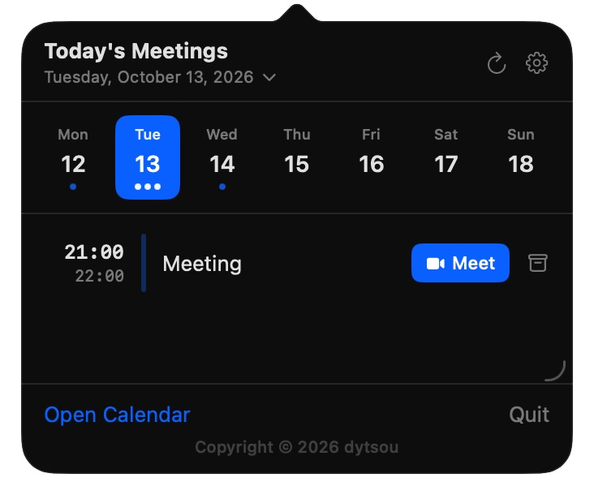

<p align="center">
  
</p>

# ProxiMeeting


[](https://github.com/dytsou/ProxiMeeting/actions/workflows/build.yml)
[](https://github.com/dytsou/ProxiMeeting/releases)
[](LICENSE)

A macOS menu bar app that shows your next meeting at a glance.



## Features

- Displays the next meeting time in the menu bar
- Shows "In Progress" when a meeting is currently active
- Popup list of meetings for the day you are browsing (opens scrolled to the first remaining meeting)
- **Browse other days:** left/right arrows or the header date control (yesterday through about two weeks ahead; window can extend as you near the edge)
- Drag the bottom-trailing corner to resize the popover
- Archive a meeting from the list to hide it from the menu-bar tray (restore the same way); with **Past events → Fade**, archived and ended items stay in the popover faded
- Auto-detects video conferencing links (Zoom, Google Meet, Teams, Webex, Whereby)
- One-click join button for detected meeting links; **Settings → Meeting links** sets **App** vs **browser** per provider (Zoom, Google Meet, Teams, Webex, Whereby)
- **Calendars:** **Settings → Calendars** limits which Apple Calendar sources are read
- **Appearance:** **Settings → Appearance** adjusts list/menu-bar fonts, title length, and whether today's past events are **Hidden** or **Faded**
- Refreshes every 60 seconds and on calendar changes
- Daily update check (GitHub Releases) with in-app update link
- Supports English and Traditional Chinese (follows system language)

## Requirements

- macOS 13 Ventura or later
- macOS Calendar app synced with your Google account
- **To build with `./build.sh`:** Xcode Command Line Tools only (~500 MB) — full Xcode is **not** required
- **To open the generated `.xcodeproj`:** full Xcode (Option B)

## Setup

### 1. Sync Google Calendar

Open **Calendar.app** → Preferences → Accounts → add your Google account. ProxiMeeting reads events directly from the system calendar — no API keys or OAuth required.

### 2. Install with Homebrew

Install the [Homebrew tap](https://github.com/dytsou/homebrew-proximeeting) (GUI app via Cask):

```bash
brew tap dytsou/proximeeting
brew install --cask proximeeting
```

#### Upgrade with Homebrew

```bash
brew update
brew upgrade --cask proximeeting
```

`brew update` only refreshes Homebrew's formula and tap metadata; it does not install or upgrade the app by itself. Check whether Homebrew manages the current installation:

```bash
brew list --cask --versions proximeeting
```

If no version is shown, install the cask first:

```bash
brew tap dytsou/proximeeting
brew install --cask proximeeting
```

If an existing app that was installed outside Homebrew causes an overwrite error, use:

```bash
brew install --cask --force dytsou/proximeeting/proximeeting
```

If Homebrew reports that the cask comes from an untrusted tap, trust only this cask and retry:

```bash
brew trust --cask dytsou/proximeeting/proximeeting
```

If ProxiMeeting is already running, `brew upgrade --cask proximeeting` quits and reopens it (cask `uninstall quit:`). Use `brew upgrade --no-quit` to skip that. If Homebrew reports the cask as installed but `/Applications/ProxiMeeting.app` is missing, repair the cask artifact with:

```bash
brew reinstall --cask --force dytsou/proximeeting/proximeeting
```

To verify the installed app version:

```bash
/usr/libexec/PlistBuddy -c 'Print :CFBundleShortVersionString' \
  /Applications/ProxiMeeting.app/Contents/Info.plist
```

If the upgrade still fails, collect verbose output with:

```bash
brew upgrade --cask proximeeting --verbose
brew doctor
```

If not using Homebrew, build the app manually.

**Option A — Command Line Tools only** (no full Xcode app):

1. Install the tools if needed. If `xcode-select --install` reports they are **already installed**, you can skip this; install updates via **System Settings → General → Software Update** when offered.

   ```bash
   xcode-select --install
   ```

2. Point the active developer directory at the standalone CLI tools (only if `xcode-select -p` shows a path inside `Xcode.app`):

   ```bash
   sudo xcode-select -s /Library/Developer/CommandLineTools
   ```

   For CLI-only builds, `xcode-select -p` should print `/Library/Developer/CommandLineTools`.

3. Build:

   ```bash
   git clone https://github.com/dytsou/ProxiMeeting.git
   cd ProxiMeeting
   ./build.sh
   ```

The script compiles with `swiftc`, creates `ProxiMeeting.app`, and offers to install it to `/Applications`.

**Option B — With Xcode** (uses xcodegen to generate the project):

```bash
git clone https://github.com/dytsou/ProxiMeeting.git
cd ProxiMeeting
./setup.sh
```

`setup.sh` installs xcodegen via Homebrew if needed, generates `ProxiMeeting.xcodeproj`, and opens it.

1. Go to **Signing & Capabilities** and select your Apple ID team
2. Press **Command+R** to build and run
3. Grant calendar access when prompted

## First launch and security

- **Menu bar app:** ProxiMeeting runs in the **menu bar** and may not appear in the Dock after launch. Look for its icon near the clock.
- **Opening from Terminal:** An `.app` bundle is a folder, not a shell command. Use **`open`**, for example:

  ```bash
  open /Applications/ProxiMeeting.app
  ```

  Or use Finder → **Applications** → **ProxiMeeting**. If Homebrew installed to your user folder, try `open ~/Applications/ProxiMeeting.app`.

- **Gatekeeper (“Apple could not verify…”):** Releases are built with ad-hoc signing and are **not** Apple-notarized, so macOS may show a warning the first time you open the app. This means the binary is not stapled with Apple’s notarization ticket—not that Apple detected malware. If you trust [this source](https://github.com/dytsou/ProxiMeeting), you can proceed: **Control-click** (or right-click) the app in Finder → **Open**, then confirm **Open**; or go to **System Settings → Privacy & Security** and use **Open Anyway** when ProxiMeeting is listed. Avoid turning off Gatekeeper entirely for the whole Mac.

## Troubleshooting: menu bar item doesn't appear

You installed ProxiMeeting, it launched, but no icon shows up near the clock — and if you **rename** the bundle before building (e.g. `APP_NAME=MeetingTrayTest make install`), the tray suddenly works. That's the telltale sign of **stale Launch Services registrations** for `com.proximeeting.app`, usually left behind by interrupted Homebrew cask upgrades (directories like `/usr/local/Caskroom/proximeeting/1.3.x.upgrading/` that no longer exist). macOS resolves the bundle id to one of those ghost rows, finds it flagged `launch-disabled`, and silently no-ops.

The one-liner recovery is:

```bash
make reset && make install
```

**What `make reset` removes** (nuclear — irreversible):

- All on-disk copies: `/Applications/ProxiMeeting.app`, `~/Applications/ProxiMeeting.app`, and the repo-local build artifact (plus the `MeetingTrayTest` diagnostic sibling if present).
- Stale Launch Services rows for `com.proximeeting.app` and `com.proximeeting.app.traytest` (via per-path `lsregister -u` followed by `lsregister -gc`).
- Per-bundle-id state under `~/Library`: `Containers/`, `Group Containers/`, `Preferences/`, `Caches/`, `HTTPStorages/`, `Saved Application State/`, `WebKit/`, `Application Support/`, and cookie stores.
- **Calendar and AddressBook TCC grants** for those bundle ids — macOS will re-prompt for calendar access the next time the app launches.
- Restarts Dock (~1 s flicker) to reload its Launch Services icon cache. Does **not** touch `cfprefsd` or any unrelated app's preferences.

**Before destroying anything**, the script prints the detected ghost rows and the exact list of paths it will remove, then asks `Continue? [y/N]`. Pass `--yes` (or set `PROXIMEETING_RESET_YES=1`) to skip the prompt in scripts/CI.

A diagnostic before/after snapshot is written to `/tmp/proximeeting-reset-<epoch>.log` — if reset-plus-install doesn't fix your tray, attach that file when reporting the issue.

If `make reset` finishes with `Reset INCOMPLETE` (exit code 1), either a ghost row survived `lsregister -gc` or a path needed `sudo`. The final banner prints the exact next command (`lsregister -delete` + reboot, or a specific `sudo rm -rf`).

## Project Structure

```
ProxiMeeting/
├── build.sh                        # Build with swiftc (no Xcode needed)
├── setup.sh                        # Generate xcodeproj with xcodegen and open
├── project.yml                     # xcodegen config
└── ProxiMeeting/
    ├── ProxiMeetingApp.swift        # App entry point + menu bar label
    ├── CalendarManager.swift       # EventKit + video link detection + archive
    ├── CalendarSelectionStore.swift # UserDefaults: which calendars to include
    ├── JoinPreferenceStore.swift   # UserDefaults: App vs browser per service
    ├── AppearanceStore.swift       # UserDefaults: fonts, past-events display, popover size
    ├── MeetingDayWindow.swift      # Multi-day browse window math
    ├── MeetingMenuView.swift       # Popup UI, settings sheets, resize handle
    ├── UpdateChecker.swift         # GitHub Releases update check
    ├── Info.plist                  # Calendar permission descriptions
    ├── ProxiMeeting.entitlements    # Sandbox + calendar entitlements
    ├── en.lproj/
    │   └── Localizable.strings
    └── zh-Hant.lproj/
        ├── Localizable.strings
        └── InfoPlist.strings
```

## Supported Video Conferencing Services

| Service         | Domain                |
| --------------- | --------------------- |
| Zoom            | `zoom.us`             |
| Google Meet     | `meet.google.com`     |
| Microsoft Teams | `teams.microsoft.com` |
| Webex           | `webex.com`           |
| Whereby         | `whereby.com`         |

Links are detected from the event URL, notes, and location fields.

**Join behavior:** Use **Settings** to set each listed provider to **App** (default) or **Browser**. **Browser** always opens a web-safe HTTPS link in your default browser and closes the panel first. **App** asks macOS to open the original URL; if no handler is installed, it closes the panel and falls back to the same HTTPS mapping as before (`zoommtg://` → `https://zoom.us/j/…`, `gmeet://` → Meet web, Teams/Meet hosts normalized to `https`, etc.). Links that are not matched to those providers always use the **Browser** path. Preferences are stored in UserDefaults.

## Contributing

See [CONTRIBUTING.md](CONTRIBUTING.md) for how to propose changes, build locally, and open pull requests.

## Adding a New Language

1. Create `ProxiMeeting/<locale>.lproj/Localizable.strings`
2. Copy keys from `en.lproj/Localizable.strings` and translate the values
3. Add the locale string to `CFBundleLocalizations` in `Info.plist`
4. Add the lproj path to `resources` in `project.yml` and re-run `./setup.sh`
